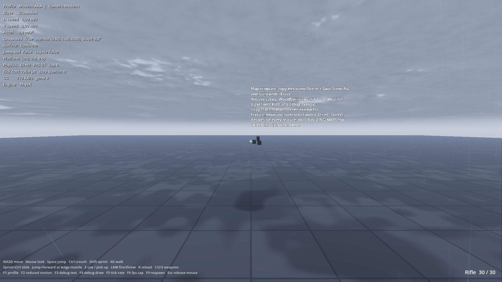

# Your first map

This page builds a small playable map: a floor, a few blocks, stairs, a pickup, and rain.
You don't write any code.



## Step 1: Copy the template

1. In the FileSystem dock, open `res://scenes/templates/map_template.tscn`.
2. Choose **Scene > Save Scene As** and save it as `res://scenes/maps/my_map.tscn`.
   Don't edit the template itself.
3. Press **F6** to play the open scene.

The template already contains everything a map needs:

```
MapTemplate
├── WorldEnvironment   weather_environment.tres + weather_camera_attributes.tres
├── Sun                DirectionalLight3D, shadows on (the weather dims it)
├── Weather            WeatherSystem (F7 cycles the weather)
├── FpsPlayer          the armed player
├── Hud, DebugOverlay  HUD and debug text (F3 / F4)
└── Level              build everything here
    └── Ground         100 x 100 m floor
```

## Step 2: Add a block

1. Select `Level`, press **Ctrl+A** and add a `StaticBody3D`. Name it `Block`.
2. Add two children to `Block`:
   - `CollisionShape3D` with a new `BoxShape3D`, size `2, 1, 2`.
   - `MeshInstance3D` with a new `BoxMesh`, size `2, 1, 2`.
3. Give the mesh a material: **Material Override > New ShaderMaterial**, set **Shader** to
   `res://addons/gamekit_weather/shaders/wet_prototype_grid.gdshader`, and pick a `color`.
4. Move the block to `y = 0.5` so it stands on the ground.

?> The static body is on collision layer 1 (World) by default. That is the layer the player walks on.

## Step 3: Stairs

Stairs are just boxes. Each step must be lower than the movement profile's `StepHeight`
(0.4 m in `modern_aaa.tres`). Duplicate the block (**Ctrl+D**) and make steps 0.25 m high and 0.4 m deep.

## Step 4: A pickup

1. Add a `RigidBody3D` under `Level` with a box shape and mesh (0.5 m).
2. **Collision > Layer**: only layer 3 (Props). **Mask**: layers 1, 2 and 3.
3. Keep `mass` under 40 kg (`InteractionRay.MaxPickupMass`).

Play the scene, look at the box and press **E** to pick it up. Press **left mouse** to throw it.

## Step 5: Weather

Select the `Weather` node. In **Presets**, the first entry is the weather the map starts with.
Drag `res://addons/gamekit_weather/presets/light_rain.tres` to the top, then play. The block and the
floor get wet because they use `wet_prototype_grid.gdshader`.

## Step 6: Make it the start scene

**Project Settings > Application > Run > Main Scene** = `res://scenes/maps/my_map.tscn`.

## Checklist

- The player's origin is at its feet. Place `FpsPlayer` just above a floor.
- Level meshes stay on render layers 1–16.
- Trigger volumes (ladders, water) use layer 4 and the right mask. See [Collision and render layers](reference/layers.md).
- Don't move static bodies from code. Use `AnimatableBody3D` for anything that moves.

## Faster: copy stations from the showcase

Open `res://scenes/examples/feature_showcase.tscn`, select a station's nodes, press **Ctrl+C**, open your
map, select `Level` and press **Ctrl+V**. Every station is already set up correctly.
