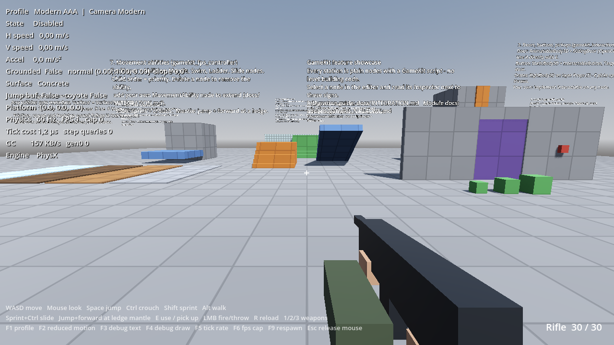
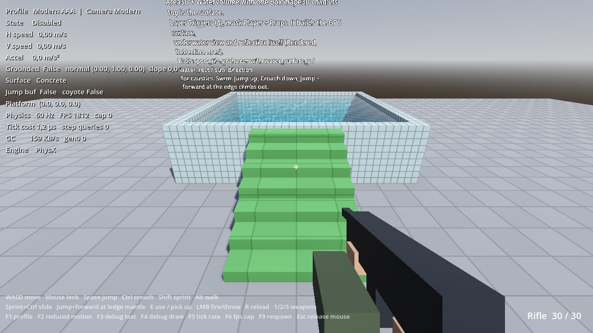
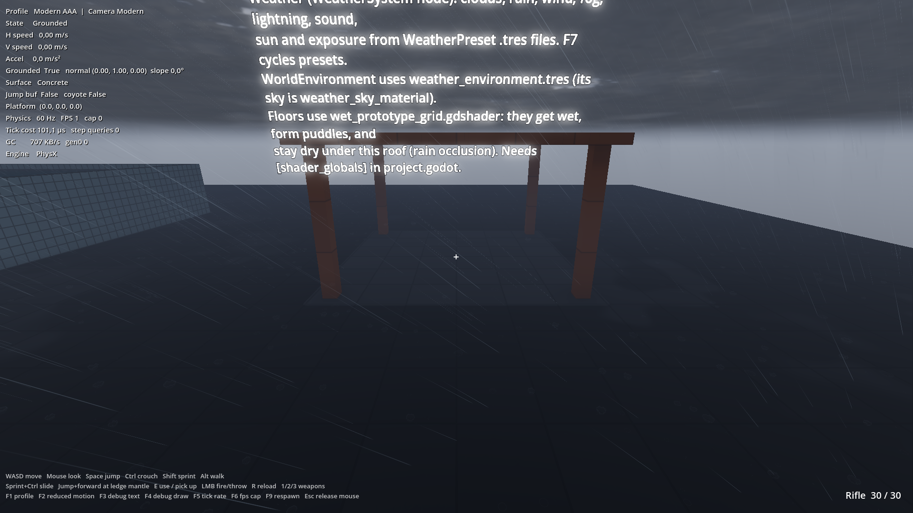

# The feature showcase

`res://scenes/examples/feature_showcase.tscn` shows every GameKit feature, built from nodes only.
Open it and press **F6**. Each station has a sign that tells you which nodes it uses.

?> This scene is in the GameClient project. The stand-alone [demo projects](getting-started/demo-projects.md)
([C#](https://github.com/Diginaat/GameKitDemoCSharp), [GDScript](https://github.com/Diginaat/GameKitDemoGDScript))
have a bigger demo map with the same stations as separate scenes.

| Station | What to try | Nodes |
| --- | --- | --- |
| Surfaces | Walk over concrete, metal, wood, grass, ice and mud; listen and feel the grip | Colliders with metadata `surface` |
| Stairs and slopes | Walk up stairs and a slope; try the too-steep slope | Plain `StaticBody3D` boxes |
| Doors, buttons, pickups | Press **E** on the button, carry and throw the crates | `SlidingDoor`, `InteractableButton`, `RigidBody3D` on Props |
| Ladder | Walk into it, look up, press **W** | `Area3D` + `LadderVolume` |
| Moving platform | Ride it, jump off it | `AnimatableBody3D` + `MovingPlatform` |
| Pool | Swim (**Space** up, **Ctrl** down), climb out at the edge | `Area3D` + `WaterVolume` |
| Movement abilities | Slide (sprint + **Ctrl**), mantle (jump + forward at a ledge) | `Abilities` child nodes of the player |
| Weather | Press **F7**; stand under the roof in rain | `WeatherSystem`, wet floors, roof as cover |

## How to learn from it

1. Select a node in the Scene dock.
2. Read its values in the Inspector, next to the sign that explains them.
3. Copy the station into your own map (see [Your first map](getting-started/first-map.md)).
