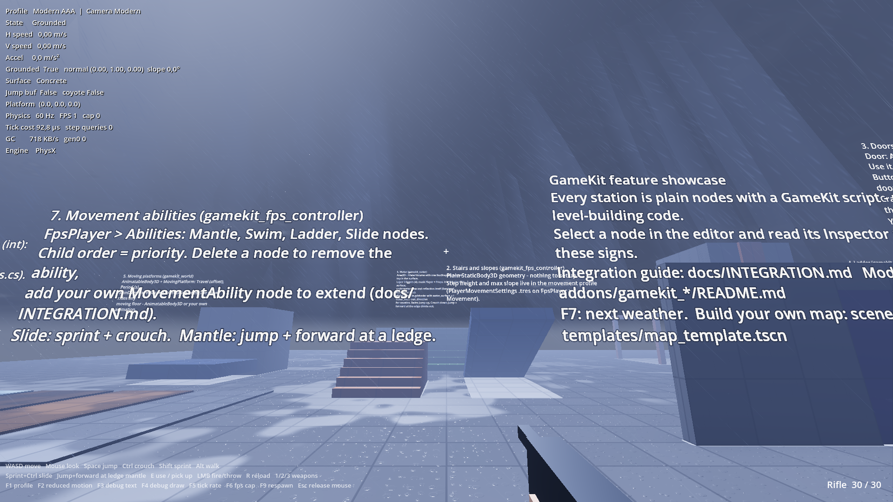

# Weather system

One `WeatherSystem` node controls the sky, clouds, rain, wind, fog, lightning, thunder, sun, exposure
and wet surfaces. It blends smoothly between weather presets.



## Set up

The map template already has all of this. For an existing scene:

1. **Shader globals.** Copy the `[shader_globals]` section into `project.godot`
   (see [Project settings](getting-started/project-settings.md)).
2. **WorldEnvironment.** Set **Environment** to
   `res://addons/gamekit_weather/resources/weather_environment.tres` and **Camera Attributes** to
   `res://addons/gamekit_weather/resources/weather_camera_attributes.tres` (auto exposure).
   Or keep your environment and set its sky material to `resources/weather_sky_material.tres`.
3. **Sun.** A `DirectionalLight3D` with shadows on.
4. **Weather node.** Add a `Node`, attach `WeatherSystem`, and set `WorldEnvironment` and `Sun`.
   Left empty, it uses the first ones in the scene.
5. **Wet materials.** Outdoor surfaces need a shader that gets wet, see [Wet surfaces](weather/wet-surfaces.md).

Press **F7** in game to cycle the weather.

## Inspector settings

| Property | Default | Meaning |
| --- | --- | --- |
| `Presets` | the six built-in | Weathers for F7 and `NextWeather()`. The **first one is the start weather** |
| `TransitionTime` | 12 | Seconds to blend to the next weather |
| `CycleAction` | `cycle_weather` | Input action that cycles; F7 is added if missing. Empty = off |
| `WettingTime`, `DryingTime` | 20, 90 | Seconds for surfaces to get fully wet / dry again |
| `CloudWindMultiplier`, `RainWindMultiplier` | 6, 0.6 | How strongly wind moves clouds and rain |
| `StormSkyDimming`, `StormFogColor`, `OvercastShadowBlur` | | How storms darken the sky and soften shadows |
| `LightningEnergy`, `LightningColor`, `LightningDistanceMin/Max` | | The lightning flash and how far away strikes are |
| `AudioEnabled` | on | Procedural rain, wind and thunder sound |

## Control it from code

```csharp
using GameKit.Weather;

var weather = GetNode<WeatherSystem>("Weather");

weather.SetWeather(GD.Load<WeatherPreset>("res://addons/gamekit_weather/presets/storm.tres"), 20f); // blend over 20 s
weather.SetWeather(preset, 0f);   // switch instantly
weather.NextWeather();            // like F7
weather.Wetness = 1f;             // start the level already wet
weather.TriggerLightning();       // a strike now

GD.Print(weather.WeatherName);    // "Storm"
weather.WeatherChanged += preset => GD.Print("Now: ", preset.DisplayName);
weather.LightningStruck += distance => GD.Print("Thunder in ", distance / 343f, " s");
```

`weather.Current` holds the blended values right now (rain intensity, wind, ...), useful for gameplay:
wet footsteps, AI looking for shelter, slower driving.

## Shelter: staying dry under roofs

Rain stops on anything above it, and surfaces under a roof stay dry. You don't set anything up: every
mesh on render layers 1–16 counts as cover. The weapon (layer 19) and water (layer 20) don't.

The cover map follows the camera and refreshes after the camera moves 4 m. If you move a roof by code,
call `weather.Occlusion?.Refresh()`.

## Sound

Rain, wind and thunder are generated in code, so no audio files are needed. They play on audio buses
`WeatherRain`, `WeatherWind` and `WeatherThunder` (created if missing), so you can set their volume in
your options menu.

## Cost

Rain only simulates a 36 m box around the camera, and the number of drops scales with the rain
intensity. Clear weather costs almost nothing. Map size doesn't matter.
